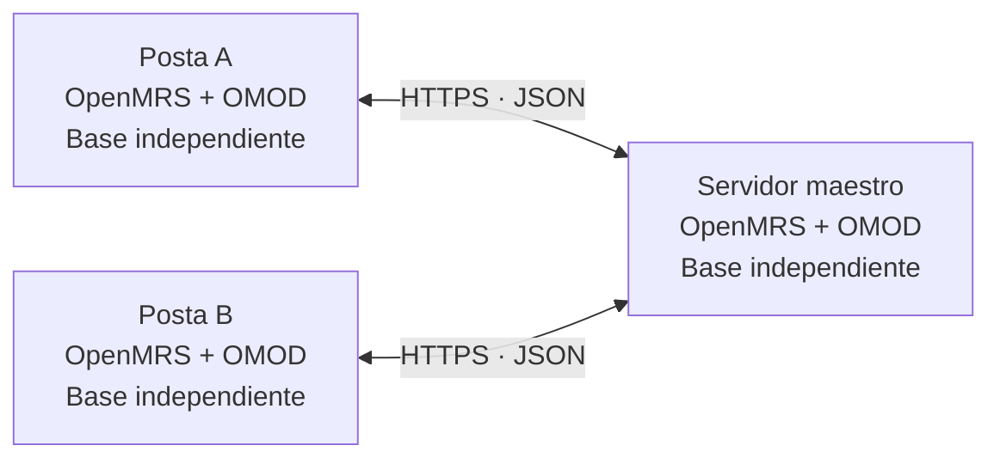

# SynchronizationMR · SIH.SALUS

**Sincronización de información clínica entre establecimientos con conectividad intermitente.**

SynchronizationMR es un módulo de OpenMRS desarrollado para el proyecto **SIH.SALUS**, en el contexto de la Microrred de Salud del Napo. Permite registrar información localmente y distribuirla entre un servidor maestro y las postas cuando el canal de comunicación está disponible.

El componente se distribuye como un archivo **OMOD** y se ejecuta dentro de OpenMRS. Sincroniza pacientes, encuentros, observaciones, visitas asociadas y órdenes mediante eventos persistentes, manteniendo la identidad de origen y el historial de las operaciones admitidas.

## Arquitectura



Las postas inician los intercambios: envían sus eventos y consultan los que les faltan. El maestro conserva el origen de los datos y permite que otras postas los reciban. También puede generar registros propios. La comunicación entre postas pasa por el maestro.

Cada instalación conserva su base de datos. El intercambio utiliza los servicios del módulo y no requiere replicación directa de bases de datos ni un motor de sincronización externo al proceso de OpenMRS.

## Capacidades

| Área | Funcionalidad |
| --- | --- |
| **Pacientes** | Altas y modificaciones de identificación, nombres, direcciones y atributos admitidos. Conserva la identidad y resuelve conflictos por grupo de datos. |
| **Encuentros** | Creación y modificación de fecha, tipo, ubicación, formulario y profesionales asociados, con resolución de conflictos por campo. |
| **Observaciones y resultados** | Captura de valores y grupos, incorporación posterior mediante `ADD_OBS`, corrección mediante `CORRECT_OBS` y anulación mediante `VOID_OBS`, conservando versiones anteriores y vínculos con órdenes. |
| **Visitas asociadas** | Inicio y fin, cierre y reapertura, tipo, ubicación, indicación y atributos admitidos. Se publican mediante sus encuentros y se actualizan con `UPDATE_VISIT`. |
| **Órdenes** | Órdenes de examen y medicamento, revisiones, renovaciones y suspensiones mediante órdenes vinculadas. Incluye estado de cumplimiento, comentario y referencia mediante `UPDATE_FULFILLMENT`. |
| **Anulaciones** | `VOID_ENCOUNTER` y `VOID_VISIT` conservan el historial y aplican las cascadas correspondientes sobre los datos clínicos asociados. |
| **Datos existentes** | Preparación explícita por lotes de pacientes, encuentros, órdenes y resultados anteriores que aún no tienen eventos publicados. |
| **Recuperación de la comunicación** | Persistencia local de eventos, intercambio periódico y continuación desde las confirmaciones registradas. |
| **Consulta entre nodos** | Identificación y recuperación de eventos por tipo de entidad, origen y secuencia, con paginación. |
| **Integridad** | Secuencias por flujo, confirmaciones consecutivas y recepción idempotente para evitar duplicados por reintentos. |
| **Seguridad** | JSON versionado sobre HTTPS, autenticación de cuentas técnicas y comprobación de permisos e identidad del nodo remoto. |
| **Auditoría** | Registro local persistente de intentos de intercambio, con identidad del evento, origen, destino, tiempos y resultado. |

## Cómo funciona

1. **Captura.** Los interceptores detectan las operaciones admitidas realizadas mediante los servicios de OpenMRS.
2. **Persistencia local.** El dato clínico y su evento se guardan en la misma transacción. El evento conserva origen, secuencia, UUID y una representación JSON.
3. **Comparación.** El proceso periódico consulta las confirmaciones del maestro y determina qué eventos enviar o recibir.
4. **Recepción.** El destino valida el mensaje y sus dependencias; guarda los datos, el evento y la confirmación dentro de una transacción.
5. **Continuación.** Los ciclos posteriores retoman los pendientes. Un reintento exacto se reconoce sin duplicar el registro.

El guardado local no espera una respuesta de red. Requiere una base local funcional, identidad de nodo configurada y contenido compatible con el contrato del módulo. Cada posta tiene su propio trabajador: el intervalo configurado es la espera después de finalizar un ciclo, no una garantía de entrega en ese plazo.

### Identidad y resolución de conflictos

Los identificadores numéricos internos de OpenMRS pueden diferir entre bases. El módulo conserva el **UUID clínico** y registra por separado el **origen y la secuencia de sincronización**. Las confirmaciones se gestionan por origen y flujo, sin asumir un contador global para toda la microrred.

Las actualizaciones comparan versiones para aplicar el cambio más reciente en la unidad correspondiente: grupo de datos del paciente, campo del encuentro o versión de la observación, visita u orden. Los desempates utilizan origen, secuencia y UUID del evento según el contrato. Las alternativas de observaciones y órdenes se conservan como historial; no se eliminan físicamente.

Las revisiones y suspensiones de una orden sobre el mismo predecesor se concilian entre sí. Las renovaciones independientes no se concilian mediante esa regla. Los encuentros y órdenes pendientes que llegan después de una anulación publicada de su contexto clínico se conservan anulados, sin reactivar la visita o el encuentro.

Las tablas propias se crean mediante Liquibase. La aplicación de datos utiliza los servicios de OpenMRS y actualizaciones JDBC específicas sobre observaciones y órdenes para completar relaciones, preservar fechas y reconciliar versiones y anulaciones.

### Auditoría

La tabla `synchronizationmr_audit` conserva los intentos de intercambio sin copiar datos clínicos ni credenciales. Requiere el privilegio `Record Synchronization Audit` en las cuentas técnicas.

- Cada intento de intercambio de una entidad tiene su propio registro. Un reintento genera otra fila y conserva el resultado anterior.
- Un envío cuya confirmación no se obtiene queda como `UNCONFIRMED`: el destinatario podría haberlo guardado aunque se haya perdido la respuesta.
- La entrega de eventos en una página (`SERVED`) no afirma que el receptor los haya guardado.
- Las consultas periódicas sin intercambio, las páginas vacías y los fallos de conexión anteriores al intercambio no generan filas de auditoría. Los fallos se comunican mediante los logs técnicos.

La auditoría se consulta mediante SQL. Registra las operaciones desde su activación y no reconstruye intercambios anteriores ni elimina automáticamente su historial.

## Organización del repositorio

```text
synchronizationmr/
├── pom.xml                     Proyecto Maven principal
├── api/
│   └── src/
│       ├── main/java/          Captura, servicios, DAO, contratos y clientes
│       ├── main/resources/     Configuración Spring y migraciones Liquibase
│       └── test/               Pruebas aisladas y con contexto OpenMRS
└── omod/
    └── src/
        ├── main/java/          Servlets de sincronización y autorización
        ├── main/resources/     Descriptor del módulo OpenMRS
        └── test/               Pruebas de endpoints y sesiones de pares
```

Puntos de entrada para revisar la implementación:

- [Captura de eventos clínicos](synchronizationmr/api/src/main/java/org/openmrs/module/synchronizationmr/advice).
- [Servicios y persistencia](synchronizationmr/api/src/main/java/org/openmrs/module/synchronizationmr/api).
- [Contratos, clientes y programación](synchronizationmr/api/src/main/java/org/openmrs/module/synchronizationmr/sync).
- [Endpoints HTTP y autorización](synchronizationmr/omod/src/main/java/org/openmrs/module/synchronizationmr/web).
- [Migraciones de la base de datos](synchronizationmr/api/src/main/resources/liquibase.xml).

## Compilación

El proyecto compila contra la API de **OpenMRS Platform 2.4.2**, con destino de bytecode Java 8. El entorno de construcción y validación utiliza **JDK 21**; el POM incluye un perfil para ejecutar las pruebas con JDK modernos.

Con Java y Maven disponibles, ejecutar desde la raíz del repositorio:

```shell
cd synchronizationmr
mvn clean install
```

El paquete instalable se genera en:

```text
synchronizationmr/omod/target/synchronizationmr-1.0.0-SNAPSHOT.omod
```

`install` compila, ejecuta las pruebas, empaqueta el módulo e instala el artefacto en el repositorio Maven local. **No lo despliega automáticamente en las instancias OpenMRS.**

## Instalación y configuración

El OMOD se incorpora mediante **Administration → Manage Modules** o el procedimiento de instalación de módulos de la distribución utilizada. Cada nodo necesita una versión compatible de OpenMRS, cuentas técnicas autorizadas y catálogos compatibles para resolver conceptos, ubicaciones, profesionales y demás referencias clínicas.

### Identidad y propiedades operativas

La comunicación y la preparación de datos existentes están **desactivadas por defecto**. Instalar el OMOD no las activa. Configurar `server.id` antes de registrar datos con el módulo activo.

| Propiedad global | Uso | Valor predeterminado |
| --- | --- | --- |
| `server.id` | Identidad única y estable del establecimiento; no cambiarla después de publicar eventos. | Vacío |
| `synchronizationmr.nodeRole` | Rol `MASTER` o `POSTA`. | `UNCONFIGURED` |
| `synchronizationmr.enabled` | Activa el intercambio periódico en una posta. En el maestro se mantiene en `false`; puede recibir y servir eventos. | `false` |
| `synchronizationmr.masterBaseUrl` | URL HTTPS de la aplicación del maestro, por ejemplo `https://maestro.example/openmrs`, sin `/spa`, `/login` ni `/moduleServlet`. | Vacío |
| `synchronizationmr.masterServerId` | `server.id` esperado del maestro. | Vacío |
| `synchronizationmr.localUsername` | Cuenta técnica local para ejecutar intercambio o preparación. | Vacío |
| `synchronizationmr.remoteUsername` | Cuenta técnica en el maestro autorizada para la posta. | Vacío |
| `synchronizationmr.intervalSeconds` | Espera entre ciclos de intercambio, de 10 a 86400 segundos. | `60` |
| `synchronizationmr.eventsPerCycle` | Máximo enviado por flujo y descargado por origen y flujo en cada ciclo, de 1 a 100. | `100` |
| `synchronizationmr.originsPageSize` | Orígenes por página, de 1 a 100; no limita el total de orígenes atendidos. | `100` |

Los cambios de configuración operativa se aplican al reiniciar el módulo. Las rutas de pacientes, encuentros y órdenes se construyen a partir de `masterBaseUrl`; no es necesario configurar cada endpoint por separado ni utilizar un script de arranque del laboratorio.

### Cuentas técnicas y contraseñas

Las cuentas deben disponer de los privilegios de consulta, recepción y auditoría del módulo, además de los permisos clínicos de las operaciones que ejecutan. Cada cuenta utilizada por un par remoto se vincula a su nodo mediante las propiedades de usuario `synchronizationmr.peerServerId` y `synchronizationmr.peerRole`.

Las contraseñas se suministran en las **propiedades privadas de ejecución de OpenMRS**, no en sus propiedades globales:

| Propiedad privada | Uso |
| --- | --- |
| `synchronizationmr.localPassword` | Contraseña de la cuenta técnica local, necesaria para los trabajadores habilitados. |
| `synchronizationmr.remotePassword` | Contraseña de la cuenta técnica remota, necesaria para el intercambio desde la posta. |

El maestro puede preparar datos existentes con su cuenta local sin habilitar el trabajador de intercambio ni configurar credenciales remotas. Las contraseñas deben mantenerse fuera del repositorio y de los registros públicos.

### Preparación de datos existentes

La preparación puede ejecutarse en maestro y postas. Publica los registros anteriores admitidos que todavía no tienen eventos de sincronización; el transporte de esos eventos utiliza el mismo mecanismo de confirmaciones.

| Propiedad global | Uso | Valor predeterminado |
| --- | --- | --- |
| `synchronizationmr.prepareExistingEnabled` | Habilita preparación de pacientes. | `false` |
| `synchronizationmr.prepareEncountersEnabled` | Prepara encuentros; requiere preparación de pacientes. | `false` |
| `synchronizationmr.prepareOrdersEnabled` | Prepara órdenes; requiere preparación de encuentros. | `false` |
| `synchronizationmr.prepareResultsEnabled` | Prepara observaciones históricas admitidas; requiere preparación de órdenes. | `false` |
| `synchronizationmr.prepareBatchSize` | Registros por lote de preparación, de 1 a 100. | `25` |
| `synchronizationmr.prepareIntervalSeconds` | Espera entre ciclos de preparación, de 10 a 86400 segundos. | `60` |

La preparación es independiente del trabajador de intercambio. Para distribuir los eventos preparados, las postas deben tener habilitada su comunicación con el maestro.

Las propiedades se declaran en el [descriptor del módulo](synchronizationmr/omod/src/main/resources/config.xml). Su resolución está en [SyncOperationalConfig](synchronizationmr/api/src/main/java/org/openmrs/module/synchronizationmr/sync/SyncOperationalConfig.java), la programación del intercambio en [PatientSyncScheduleConfig](synchronizationmr/api/src/main/java/org/openmrs/module/synchronizationmr/sync/PatientSyncScheduleConfig.java) y la preparación en [PatientPreparationScheduler](synchronizationmr/api/src/main/java/org/openmrs/module/synchronizationmr/sync/PatientPreparationScheduler.java).

### Canal de comunicación

Las postas necesitan acceso HTTPS al maestro, un certificado válido para el nombre del servidor y confianza configurada en su JVM. HTTPS puede proporcionarlo el servidor OpenMRS o la infraestructura de publicación existente. El componente no exige el contenedor Nginx utilizado en el laboratorio. Una VPN puede proporcionar conectividad, pero no sustituye la exigencia HTTPS del transporte.

Si se utiliza un proxy, OpenMRS debe reconocer la conexión original y confiar únicamente en el intermediario previsto. El cifrado del tramo entre el proxy y OpenMRS depende de la configuración de esa infraestructura: HTTPS en el punto de entrada no implica por sí solo que ese tramo interno esté cifrado.

Para una aplicación publicada bajo `/openmrs`, los endpoints son:

```text
/openmrs/moduleServlet/synchronizationmr/patientSync
/openmrs/moduleServlet/synchronizationmr/encounterSync
/openmrs/moduleServlet/synchronizationmr/orderSync
```

## Pruebas y validación

La batería automatizada comprende **540 casos en 43 suites: 478 casos de API y 62 de OMOD**, con ejecución completa sin fallos, errores ni omisiones. Incluye pruebas aisladas, integración con servicios OpenMRS y H2, migraciones Liquibase y pruebas web con solicitudes simuladas y autorización de pares.

Comprueba captura transaccional, secuencias concurrentes, contratos, dependencias, conflictos, anulaciones, preparación histórica, reintentos, auditoría y configuración. El número de casos no representa un porcentaje de cobertura del código.

La validación funcional utiliza un laboratorio con un maestro y dos postas, bases MariaDB independientes y datos ficticios. Abarca altas y modificaciones, corrección de observaciones, visitas, órdenes y resultados, conflictos, preparación de datos existentes y recuperación tras interrupciones de comunicación. Los metadatos de encuentros tienen cobertura automatizada; no se presentan como un ensayo multinodo. La validación de laboratorio no equivale a una certificación de cualquier infraestructura, formulario o catálogo externo.

Para ejecutar la batería y generar el paquete desde `synchronizationmr`:

```shell
mvn package
```

Los reportes se generan en `api/target/surefire-reports` y `omod/target/surefire-reports`. Las pruebas automatizadas no requieren levantar las tres instancias del laboratorio.

## Alcance

- Se sincronizan las entidades y operaciones descritas dentro de sus contratos admitidos. Diagnósticos estructurados, Conditions, imágenes y archivos complejos quedan fuera de ese alcance.
- Las visitas se publican mediante sus encuentros, no como un flujo independiente de visitas vacías.
- La anulación es lógica y conserva historial. No se ofrece borrado físico ni restauración de registros anulados.
- No se realiza conciliación automática de pacientes creados independientemente ni distribución de profesionales o catálogos. Las referencias utilizadas deben ser compatibles entre nodos.
- Las correcciones conservan las versiones y los vínculos de observaciones. La cadena nativa `previous_version` representa la rama ganadora; las alternativas se conservan en el historial del módulo. No se inventan relaciones entre observaciones que el formulario guardó sin un vínculo de versión reconocido.
- Una edición puede producir varios eventos que se reciben por separado, por lo que puede existir un estado intermedio hasta completar la entrega. Corregir un resultado no modifica ni cancela la orden que lo solicitó.

## Licencia

Consultar [LICENSE](LICENSE) y los avisos de licencia incluidos en los archivos fuente.
